<div align="center">

<p></p>

[](https://www.durham.ac.uk)
[](https://www.hackthebox.com)
[](https://overthewire.org)


</div>

I study Computer Science at Durham University. My main interest is cybersecurity, and I care just as much about the engineering behind it: I like building tools that make systems easier to understand and defend.

## `~/security`

### [Log Analysis Platform](https://github.com/CutGrass88/log-analysis)

> A Django web app that parses Apache access logs and flags suspicious activity for investigation.
>
> **Detects:** request bursts · repeated auth failures · path scanning · sensitive-path probes · suspicious HTTP methods · payload probes · slow-request abuse
>
> A two-person project. I wrote the detection rules, the pandas processing and the Django backend.
>
> `Python` `Django` `pandas` `SQLite` `AWS S3`

### Labs and CTFs

> Hack The Box and OverTheWire, always in legal lab environments.
>
> Enumerating services with Nmap, following TCP streams in Wireshark, OpenSSL for cryptography exercises, and investigating files, processes and services from the Linux command line.
>
> `Linux` `Nmap` `Wireshark` `OpenSSL` `Bash`

## `~/toolkit`

```text
Security    │  log analysis · detection rules · packet analysis · network enumeration
Networking  │  TCP/IP · DNS · HTTP
Sec tools   │  Nmap · Wireshark · OpenSSL
Languages   │  Python · Bash · C# · JavaScript · HTML/CSS
Backend     │  Django · Node.js · Express · REST APIs · SQLite · pandas
Testing     │  Jest · unit and API tests · GitHub Actions CI
Platforms   │  Linux · Windows · PowerShell · Docker · Git · AWS S3
```

## `~/projects`

| Project | What it is | Built with |
| --- | --- | --- |
| [Terra Nova](https://github.com/SamsSide/Durhack-2026) | DurHack 2026, built in 24 hours by a team of three. Type one line and a living 3D planet builds itself, run by AI nations that trade on Solana. My part: the globe and the Solana economy. | TypeScript · three.js · Solana |
| [RepShelf](https://github.com/CutGrass88/repshelf) | Workout planner with a REST API and server-side input validation. 109 API and client tests, including malformed requests and failed-write recovery, run in CI on Linux and Windows. | JavaScript · Express · Jest |
| [Meetly+](https://github.com/CutGrass88/Meetly-Plus) | DurHack 2025. Ranks the fairest meeting hub for 2 to 25 travellers by distance, travel time and CO₂. I led a team of three and built the backend. | Python · Gemini API |
| [Orbital Simulation](https://github.com/CutGrass88/Orbital-Simulation-WPF) | Multi-body gravity simulator that computes pairwise forces and steps them with semi-implicit Euler integration, with save, load and live inspection. | C# · WPF · .NET |
| [LeetCode solutions](https://github.com/CutGrass88/leetcode-solutions) | Python solutions, organised by topic. | Python |

## `~/showcase`

<div align="center">
<table>
  <tr>
    <td align="center" width="33%">🛡️<br><b>Cyber scholarship</b><br><sub>Government-funded</sub></td>
    <td align="center" width="33%">🚩<br><b>SillyCTF</b><br><sub>Top 50</sub></td>
    <td align="center" width="33%">🔐<br><b>National Cipher Challenge</b><br><sub>Top 50</sub></td>
  </tr>
</table>
</div>

## `~/now`

```text
studying    │  Year 2 at Durham: Networks and Systems · Software Engineering · Programming Paradigms
practising  │  Hack The Box · OverTheWire
side quest  │  a car mod for a racing sim, built from scratch (private for now)
```

## `~/lawn`

<div align="center">

<picture>
  <source media="(prefers-color-scheme: dark)" srcset="https://raw.githubusercontent.com/CutGrass88/CutGrass88/output/lawn-dark.svg">
  
</picture>

<sub>My last three months on GitHub. Taller grass is a busier day. If I stop contributing, the mower falls asleep and the weeds move in.</sub>

</div>

## `~/contact`

[](https://www.linkedin.com/in/denis-ivanciuc-370980398)
